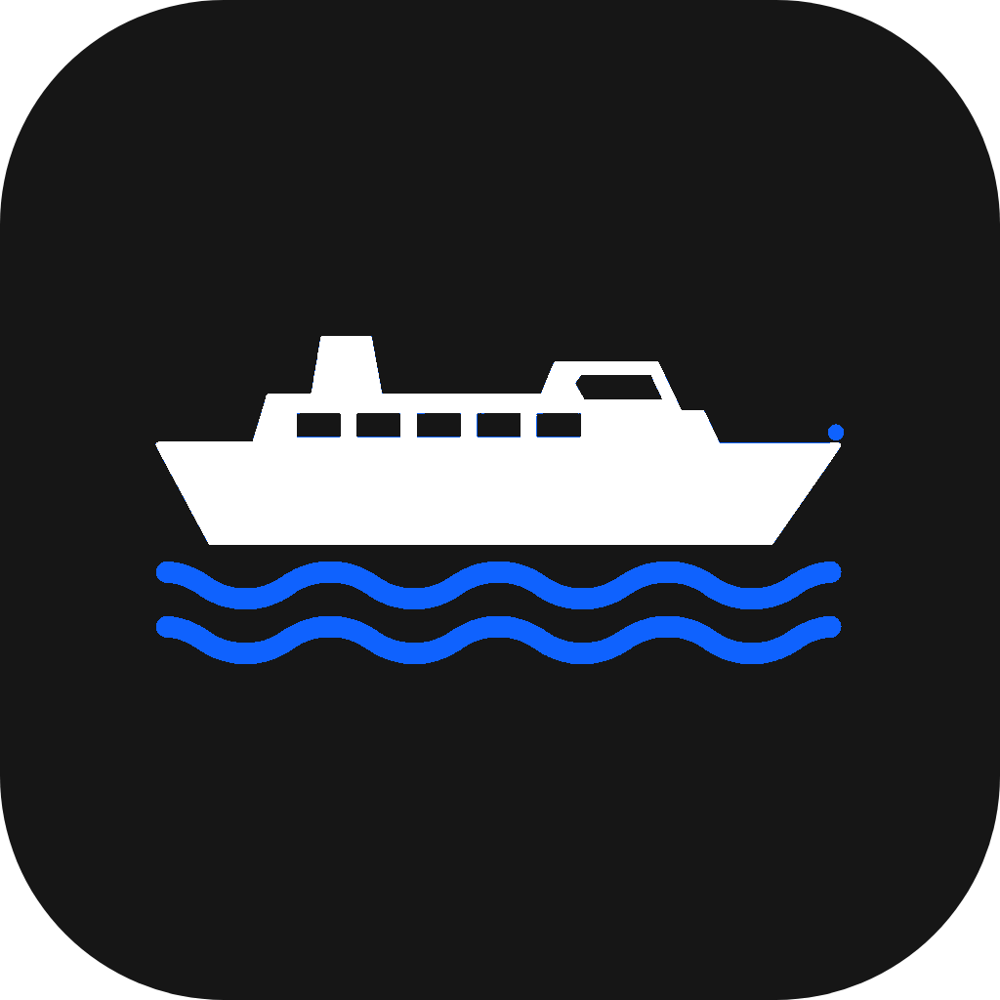
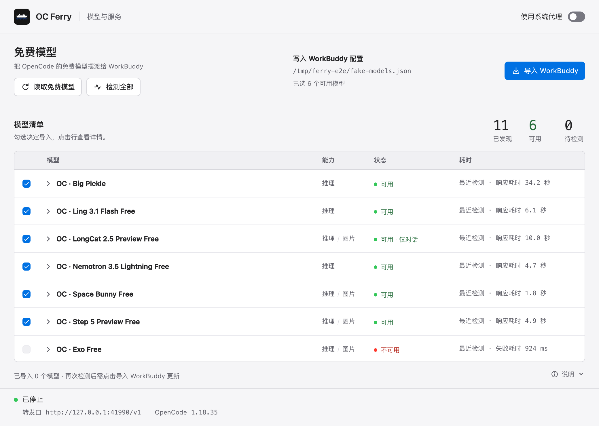
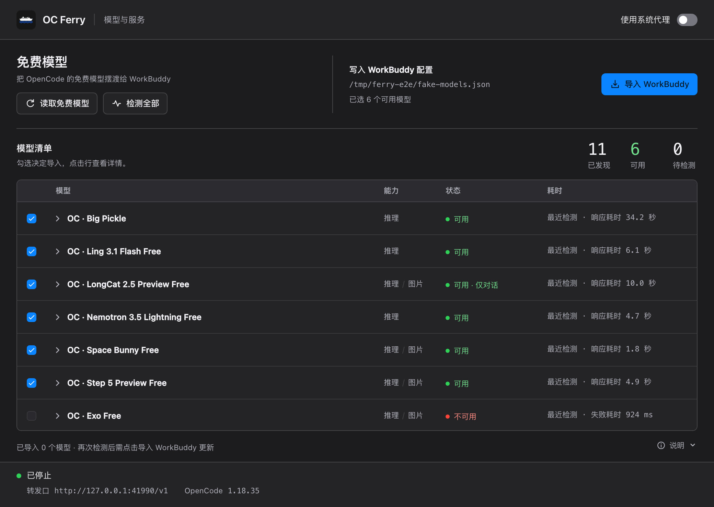
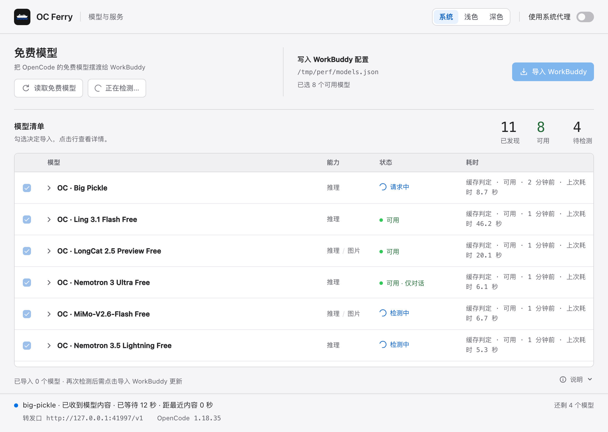
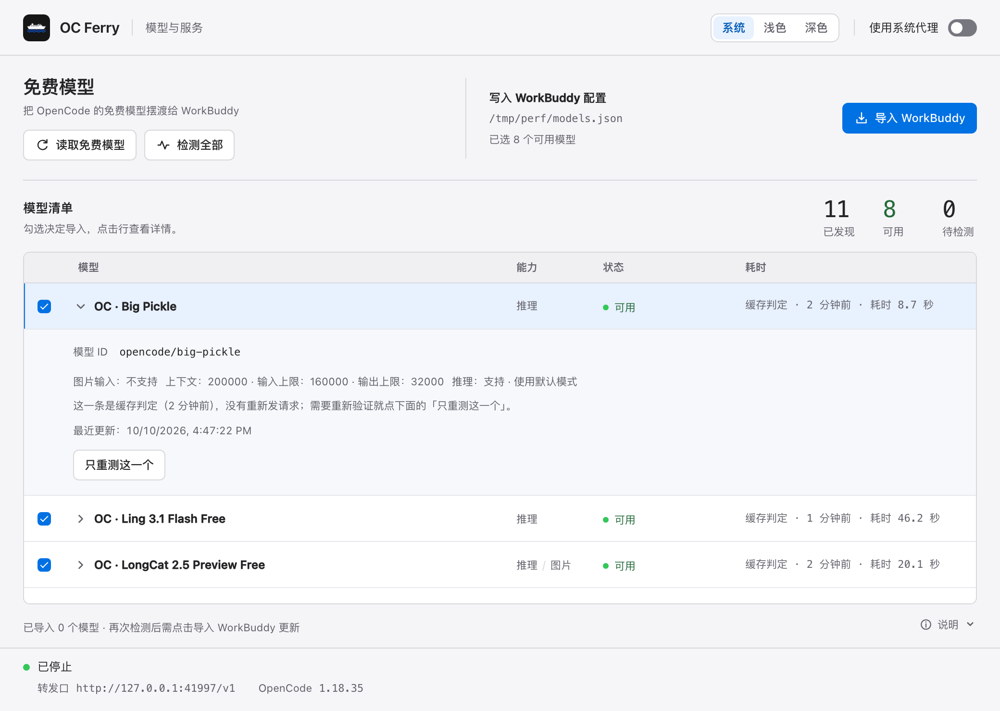
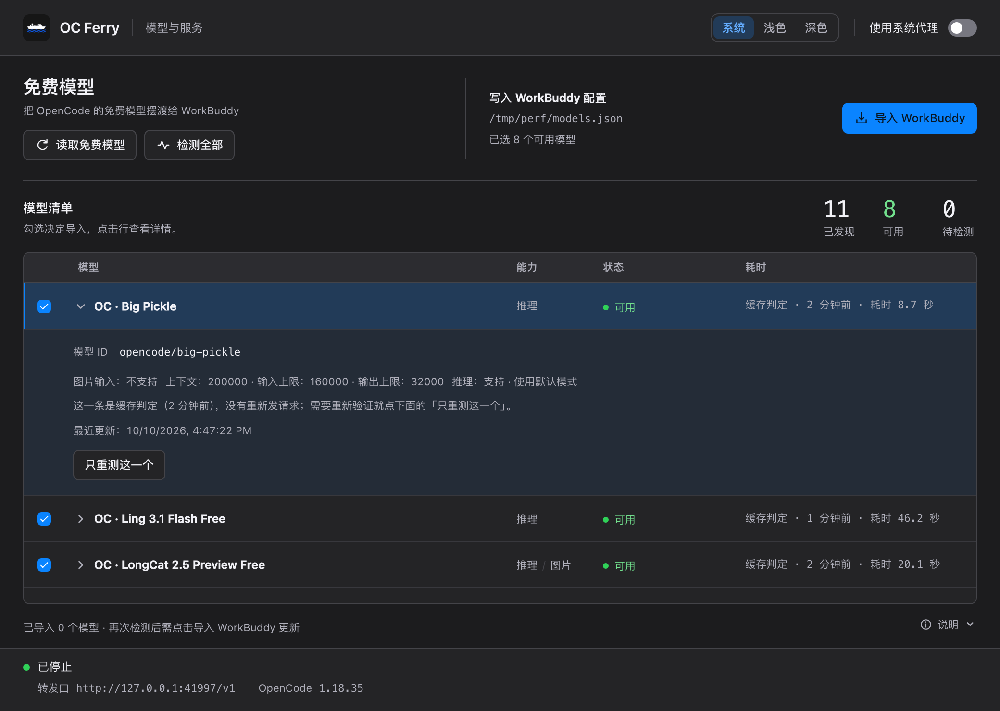
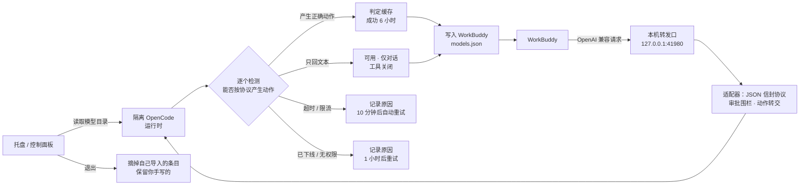

<div align="center">
  
  <h1>OC Ferry</h1>
  <p><b>把 OpenCode 的免费模型摆渡给 WorkBuddy</b></p>
  <p>跨平台托盘应用 · 无需登录注册、无需 API Key · 隔离运行时 · 并发检测 · 判定缓存 · 一键导入 · 本机 OpenAI 兼容转发口</p>

  
  
  
  
</div>

---

WorkBuddy 支持在它的 `models.json` 里填自定义模型。OpenCode 的免费模型池是现成的免费额度，但它不是一个能直接填进去的 OpenAI 端点：目录里带 `free` 的模型不一定免费，能聊天不等于能按 WorkBuddy 的方式产生工具调用，而且免费池随时上下线。

**OC Ferry 就是中间这一层**：在数据目录里放一份**隔离的** OpenCode，按**价格**筛出免费模型，逐个探测它们能不能按 WorkBuddy 的工具协议干活，把通过的写进你的 `models.json`，再起一个只监听本机的转发口供 WorkBuddy 调用。

## 界面

浅色与深色两套主题，四档状态一眼可读；检测是并发的，多个模型同时跑。



<table>
<tr><td width="50%"></td><td width="50%"></td></tr>
<tr><td align="center">深色主题</td><td align="center">并发检测：多路同时跑，底部实时显示还剩几个</td></tr>
<tr><td></td><td></td></tr>
<tr><td align="center">行内展开详情，可「只重测这一个」</td><td align="center">判定来自缓存时如实标注</td></tr>
</table>

## 工作流程



**五条核心链路**

1. **发现**：只看价格字段（输入/输出/缓存读写全为 0）才算免费，名字里带 `free` 不算数；已声明 `deprecated` 的直接排除。
2. **体检**：给 5 个工具、自由选择，让它读一个带随机 token 的文件。**只回文本不算失败**——按「可用 · 仅对话」发布并关掉工具；动作不符重试一次；超时与格式失败不重试。
3. **提速**：检测 3 路并发（一轮约 60 秒）；判定按模型缓存，成功保留 6 小时、当时的负载只保留 10 分钟——**重启基本是秒开，不会每次都全量重测**。
4. **导入**：只增删自己标记过的条目，你手写的一条都不动；写前备份、加锁、原子替换，内容没变就不写；退出时把自己的条目摘干净。
5. **转发**：模型只能回一个 JSON 信封表达动作，**执行权始终在 WorkBuddy 手里**——任何本机动作一律被拒绝或转交成外部工具调用，模型永远不会自己动手。

## 用法

先安装 WorkBuddy。**不需要另外装 Node.js**（打包后的应用用 Electron 自带的 Node 跑后台服务）。

- **macOS（Apple 芯片）**：下载 `OC-Ferry-<版本>-mac-arm64.dmg`（仓库右侧 Releases 里），双击打开，把 `OC Ferry` 拖进「应用程序」，再双击打开。未做 Apple 公证，首次打开可能要右键 →「打开」；若提示「已损坏」，先核对 Release 说明里的 sha256，再移除下载隔离标记：`xattr -dr com.apple.quarantine "/Applications/OC Ferry.app"`。也可以下载 zip，解压后把 `OC Ferry.app` 拖进「应用程序」。
- **Windows**：运行 `OC-Ferry-Setup-<版本>-win-x64.exe`，装完桌面就有了图标，双击即开。
  安装包会同时做两件事：把**开机自启**写进当前用户的 Run 项（启动参数 `--hidden`，开机后只常驻托盘、不弹窗）、并保证卸载时把这一条摘干净。
  因此装完就等于「一直连着」——不用每次先开一次应用，WorkBuddy 里的免费模型才在。
  （只想要绿色版的话用 `npm run build:win:portable`；portable 包必须完整解压，不要只复制 exe。）

首次启动会自动准备 OpenCode、扫描免费模型并逐个检测，**检测完自动导入一次**。之后重新检测或读取**不会**自动改 WorkBuddy，需要点「导入 WorkBuddy」。

几个日常操作：

- **关窗口 ≠ 退出**：关掉窗口它继续在托盘跑；从托盘退出时会把自己导入的条目摘掉（保留你手写的），所以这些模型可用期间请让它常驻。
- **想重新验证**：点「检测全部」强制重测一轮；只想重测某一个，在它的详情里点「只重测这一个」。
- **主题**：工具栏右上角可在**系统 / 浅色 / 深色**之间切换，选择会记住。

## 开发

```sh
npm ci
npm test              # 85 项自动测试，不访问网络
npm run desktop       # 起 Electron（窗口 + 托盘 + 后台服务）
npm start             # 只起后台服务（无界面），用于调试
npm run build:mac     # 打 macOS 的 .app + zip + dmg（ad-hoc 签名 + 深度严格校验）
npm run build:dmg     # 只重打安装包（复用已构建的 .app，几秒钟）
npm run build:win     # 打 Windows 安装包（NSIS，桌面图标 + 开机自启）
npm run build:win:portable   # 打 Windows 便携版（不写注册表、不自启）
```

### 数据目录

| 系统 | 应用数据 | WorkBuddy 配置 |
|---|---|---|
| macOS | `~/Library/Application Support/OC Ferry` | `~/.workbuddy/models.json` |
| Windows | `%APPDATA%\OC Ferry` | `%USERPROFILE%\.workbuddy\models.json` |
| Linux（实验性） | `$XDG_CONFIG_HOME/OC Ferry` | `~/.workbuddy/models.json` |

数据目录里：`api-key`（本机转发口的密钥）、`status.json`、`settings.json`、`probe-cache.json`（判定缓存）、`runtime/`（托管运行时）、`opencode/`（隔离 OpenCode 自己的目录）。

**环境变量**（调试用）：`FERRY_DATA_DIR`、`FERRY_PORT`（默认 41980）、`FERRY_MODELS_FILE`、`FERRY_NO_SYNC=1`（完全不写 WorkBuddy）、`FERRY_OPENCODE_PATH`、`FERRY_PROBE_CONCURRENCY`（并发度，默认 3，上限 6）、`FERRY_PROBE_TTL_MINUTES`（成功判定有效期，默认 360 分钟）、`WORKBUDDY_CONFIG_DIR` / `WORKBUDDY_DATA_FOLDER_NAME`。

### 本机接口

所有路由都要 `Authorization: Bearer <数据目录>/api-key`，带 `Origin` 头的请求一律 403（这个端口不给浏览器用）。

```
GET  /health                 # 完整状态
GET  /v1/models              # 已判定可用的模型（id 为 "OC · 名字"）
POST /v1/chat/completions    # 转发，支持 stream；并发上限 4
POST /admin/refresh | /admin/probe | /admin/import | /admin/selection
POST /admin/system-proxy | /admin/find-config
```

### 代码结构

```
src/
  main.js            编排：状态机 / 检测队列 / 刷新 / 导入 / 退出清理
  backend.js         OpenCode 会话、审批围栏、事件流、动作转交与翻译
  runtime.js         运行时发现·下载·校验·隔离启动
  protocol.js        请求校验 / 信封编解码 / usage 换算 / SSE
  probe.js           检测请求与判定规则
  probe-cache.js     判定缓存：跨重启复用，按能力指纹与过期时间失效
  repair.js          翻译兜底：系统提示、材料打包、诊断重发
  handoff.js         本机动作 → 外部工具的映射与 schema 复核
  config-finder.js   Windows 配置查找（只读）
  sync.js            models.json 的合并 / 加锁 / 备份 / 原子写
  server.js          本机 HTTP 面（鉴权、来源围栏、转发）
  platform.js  system-proxy.js  atomic.js  json.js
  service-instance.js  model-status.js  reasoning.js  workbuddy-config.js
desktop/
  main.cjs           Electron：窗口、托盘、受限 IPC、服务生命周期
  preload.cjs        只暴露状态订阅与固定动作
  index.html  style.css  renderer.js   控制面板
  activity.cjs       托盘与面板共用的阶段文案
test/                85 项自动测试
docs/
  设计说明.md         架构、协议、机制与边界（模块地图 / 信封协议 / 审批围栏 / 缓存策略）
  screenshots/       界面截图
```

## 诚实交代

- 启动后会自动发送简短的检测请求，**会使用少量免费额度**；检测通过只代表"这一次能按协议产生动作"，不代表完整工作流都验证过。
- 界面上的耗时是**完整请求用时**，不是首字延迟；剩余额度上游不提供，查不到。
- 不可用的模型只在窗口里保留记录，**不会**提供给 WorkBuddy。
- 免费模型与额度由上游决定，随时可能变化。
- 系统代理只支持手动 HTTP/HTTPS 配置，**不支持 PAC/SOCKS**。

## License

[MIT](LICENSE)

---

<div align="center">
  <p>如果这个工具帮到了你，可以请我喝杯咖啡 ☕</p>
  
</div>
